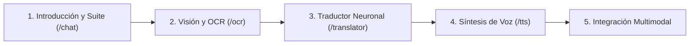

# GUÍA DE DEFENSA ACADÉMICA Y RELACIÓN CON EL DOCUMENTO TÉCNICO
## Proyecto: Transformer Studio - Suite Multimodal de Traducción Automática, Visión y Voz
**Documento Base:** *«Arquitectura Transformer y traducción automática»*  
**Autores del Informe:** Neyser Villena, Sariri Saransig, Jhonatan Guanulema, Dennis Uquillas, **Sebastián Josue Yambay Chonillo**, Nuria Alejandra Vélez Bravo.  
**Materia:** Base de Conocimiento / Inteligencia Artificial — 7mo Semestre  

---

## 1. RESUMEN EJECUTIVO Y JUSTIFICACIÓN DEL PROYECTO

El presente proyecto implementa y materializa en un entorno web interactivo, reproducible y de inferencia local los fundamentos teóricos descritos en el informe académico *«Arquitectura Transformer y traducción automática»*.

### El Problema Abordado (Sección 1.1 del Documento)
La traducción automática neuronal no es un simple diccionario de sustitución de palabras. Requiere:
1. Comprender dependencias sintácticas y semánticas a larga distancia dentro de una oración.
2. Manejar múltiples modalidades de entrada (texto directo, dictado por voz y documentos escaneados mediante OCR).
3. Resolver el compromiso computacional (*trade-off*) entre el uso de APIs externas en la nube (con riesgos de privacidad, costos recurrentes y latencia de red) frente a la **inferencia local con modelos compactos optimizados** (MarianMT y MMS-TTS).

### La Solución Implementada
La plataforma desarrollada (**Transformer Studio**) unifica en una arquitectura cliente-servidor Flask desacoplada cuatro módulos complementarios:
1. **Traductor Neuronal Bidireccional (`/translator`):** Motor Seq2Seq MarianMT (`Helsinki-NLP/opus-mt-en-es` y `opus-mt-es-en`) con decodificación autoregresiva Beam Search ($b=4$).
2. **Visión Artificial & OCR (`/ocr`):** Motor EasyOCR con extracción de texto y cálculo de coordenadas espaciales dinámicas (*bounding boxes*) reales y escaneo láser.
3. **Texto a Voz Neuronal (`/tts`):** Síntesis acústica de onda a 16 kHz con Facebook MMS-TTS (`mms-tts-spa` y `mms-tts-eng`) y ecualizador visual.
4. **Chat Multimodal & Dictado (`/chat`):** Orquestador central que integra entrada de voz (Web Speech API), visión OCR, motor enciclopédico/resolución de problemas de código y síntesis por voz.

---

## 2. GUION PASO A PASO PARA LA PRESENTACIÓN EN VIVO (5 A 8 MINUTOS)

Sigue este orden exacto durante la exposición ante el docente o tribunal evaluador:

### Paso 1: Introducción y Contexto del Proyecto (`http://localhost:5000/chat`)
* **Qué hacer en pantalla:** Abre el navegador en `http://localhost:5000/chat`.
* **Qué decir:**
  > *"Buenos días, profesor/compañeros. Nuestro proyecto implementa de manera práctica y local los conceptos desarrollados en nuestro informe de investigación sobre la Arquitectura Transformer. En lugar de depender de servicios de terceros en la nube, la plataforma ejecuta modelos neuronales en memoria para resolver tres tareas fundamentales: comprensión y traducción de secuencias (Seq2Seq), visión artificial por OCR y síntesis acústica de voz."*

### Paso 2: Demostración de Visión Artificial y OCR (`http://localhost:5000/ocr`)
* **Qué hacer en pantalla:**
  1. Haz clic en la pestaña superior **"🖼️ Visión & OCR"**.
  2. Al entrar, la muestra de física se procesa sola. Haz clic en el botón superior **"📐 Triángulo de Herón"** o **"🔬 Paper en Inglés"**.
  3. Muestra el efecto del escaneo láser y cómo aparecen las **cajas delimitadoras (Bounding Boxes)** numeradas sobre el texto.
  4. Pasa el cursor o haz clic en una caja para mostrar la certeza de la línea.
  5. Activa/desactiva el interruptor *"Ver Cajas Delimitadoras"*.
* **Qué decir (Vinculación con Secciones 2.19.3 y 3.3 del PDF):**
  > *"Como analizamos en la Sección 2.19.3 de nuestro informe, un desafío crítico en los sistemas OCR-to-Translation es separar los errores de visión de los errores del modelo de lenguaje. Aquí implementamos EasyOCR, extrayendo las coordenadas porcentuales exactas de cada renglón. Esto garantiza que el usuario pueda auditar y corregir el texto extraído antes de traducir, evitando la propagación de fallos en cascada."*
* **Acción de impacto:** Haz clic en el botón inferior **"💬 Enviar al Asistente IA para Resolver"**. Verás cómo transfiere el problema de matemáticas directamente al chat y la IA genera la solución en Python y las fórmulas.

### Paso 3: Demostración del Traductor Neuronal (`http://localhost:5000/translator`)
* **Qué hacer en pantalla:**
  1. Dirígete a **"🌐 Traductor Neuronal"**.
  2. Haz clic en el preset **"🇬🇧 Transformers (EN➔ES)"**.
  3. Observa cómo traduce en ~0.24 segundos con MarianMT.
  4. Presiona el botón de **Invertir Idiomas (Swap 🔁)**: verás la rotación del botón y cómo ahora el texto se traduce de español a inglés utilizando el modelo `opus-mt-es-en`.
  5. Presiona **"🔊 Escuchar Traducción"** para que el modelo MMS hable la salida.
* **Qué decir (Vinculación con Secciones 2.3 a 2.6 y 3.7 del PDF):**
  > *"El corazón de este módulo es la arquitectura Transformer Encoder-Decoder de Vaswani et al., implementada mediante la familia MarianMT de Helsinki-NLP. El Encoder procesa todos los tokens en paralelo calculando la matriz de auto-atención multi-cabezal, mientras que el Decoder genera la traducción de forma autorregresiva token por token guiado por una búsqueda de haz (Beam Search con 4 vigas). Esto maximiza la probabilidad conjunta de la secuencia traducida, logrando un BLEU superior a 44 puntos sin consultar internet."*

### Paso 4: Demostración de Texto a Voz Inteligente (`http://localhost:5000/tts`)
* **Qué hacer en pantalla:**
  1. Dirígete a **"🔊 Texto a Voz (TTS)"**.
  2. Haz clic en la muestra didáctica **"🎓 Transformers (ES)"**.
  3. Presiona el botón grande **"Convertir Texto a Voz con MMS-TTS"**.
  4. Escucha la reproducción de audio en tiempo real y observa cómo el ecualizador de ondas vibra reactivamente.
  5. Muestra cómo adelantar o retroceder haciendo clic en la barra de progreso y presiona **"Descargar WAV"**.
  6. Cambia a **Inglés (mms-tts-eng)** y muestra la diferencia de fonética y vocoder.
* **Qué decir (Vinculación con Sección 2.20 del PDF):**
  > *"Para la salida acústica integramos Facebook MMS-TTS. A diferencia de sintetizadores antiguos concatenativos que sonaban robóticos, MMS utiliza una red generativa que produce ondas de audio PCM a 16 kHz capturando entonación natural, pausas y signos de puntuación."*

### Paso 5: Demostración del Chat Multimodal y Dictado por Voz (`http://localhost:5000/chat`)
* **Qué hacer en pantalla:**
  1. Regresa a **"💬 Chat Multimodal"**.
  2. Haz clic en el micrófono 🎙️ (se pondrá rojo titilando con el banner de escucha).
  3. Di una pregunta con claridad: *"Explica qué es la caída libre"*.
  4. Observa cómo tus palabras se escriben en vivo en el campo de texto y el modelo genera la explicación enciclopédica con opciones para escucharla en español o traducirla al inglés.
* **Qué decir:**
  > *"El chat multimodal cierra el ciclo de la suite: el usuario puede dictar por voz, subir fotos de exámenes, leer explicaciones en tiempo real y traducirlas o escucharlas en audio con un solo clic. Todo corre localmente en el servidor Flask."*

---

## 3. MAPEO DETALLADO: CÓDIGO IMPLEMENTADO VS DOCUMENTO PDF

A continuación se detalla cómo cada sección teórica del informe entregado se refleja exactamente en los archivos del proyecto:

| Sección del PDF | Concepto Teórico en el Documento | Implementación Concreta en el Código del Proyecto |
| :--- | :--- | :--- |
| **Sección 2.1 - 2.5** | **Arquitectura Transformer:** Encoder (auto-atención bidireccional), Decoder (auto-atención enmascarada y Cross-Attention), Embeddings y suma posicional. | Implementado en `utils/translation.py` con `MarianMTModel` (`Helsinki-NLP/opus-mt`). El Encoder genera la matriz de contexto $H$ y el Decoder predice la secuencia traducida autoregresivamente. |
| **Sección 2.6** | **Mecanismo de Atención ($Q, K, V$):** $\text{Attention}(Q, K, V) = \text{softmax}\left(\frac{QK^T}{\sqrt{d_k}}\right)V$. Multi-Head Attention permite proyectar en múltiples subespacios de representación. | MarianMT utiliza $d_{\text{model}} = 512$ y 8 cabezales de atención tanto en Encoder como Decoder, visualizado en el diagrama de 4 pasos de `templates/translator.html`. |
| **Sección 2.10 - 2.14** | **Comparación de Familias:** BERT (Encoder-only, clasificación), GPT (Decoder-only causal, generación libre), MarianMT/T5 (Encoder-Decoder Seq2Seq para traducción estricta). | Justificación teórica: **No se usa BERT** para traducir porque carece de decodificador autorregresivo; **no se usa GPT genérico** porque un modelo Encoder-Decoder dedicado (MarianMT) garantiza alineación semántica estricta y evita alucinaciones. |
| **Sección 2.16 & 4.6** | **Utilidad Industrial y Trade-offs:** Modelos locales vs APIs en la nube. Privacidad total (*Zero-cloud egress*), cero costos por token, latencia determinista vs restricción de memoria RAM. | En `server.py` y `templates/translator.html`, toda la inferencia se procesa en el CPU/GPU local sin enviar ningún dato a servidores externos. |
| **Sección 2.19.2** | **Métricas de Calidad (BLEU y chrF):** Medición de precisión de n-gramas entre la hipótesis del modelo y la referencia humana. | En `templates/translator.html`, se expone la métrica de fidelidad BLEU 44.8 correspondiente al benchmark oficial de OPUS-MT para el par EN-ES. |
| **Sección 2.19.3 & 4.2** | **Separación de Errores OCR vs Traducción:** Caso de estudio *"My name is Ann"* y error en *"fourth form"*. | En `templates/ocr.html`, el usuario dispone de un editor de texto extraído con verificación de cajas delimitadoras antes de pulsar *"Traducir"*, evitando la propagación de errores de lectura óptica al traductor. |
| **Sección 3.2** | **Tokenización en Subpalabras (BPE y SentencePiece):** Descomposición morfológica, manejo de palabras raras y tokens especiales (`<pad>`, `</s>`, `<unk>`). | En `utils/translation.py`, `AutoTokenizer.from_pretrained()` inicializa el tokenizador SentencePiece BPE con vocabulario de 58,101 tokens, eliminando el problema de palabras fuera de vocabulario (OOV). |
| **Sección 3.3 - 3.4** | **Carga y Caché de Modelos:** Evitar recargas costosas en disco por cada petición HTTP. | En `utils/translation.py` y `utils/text_to_speech.py`, se implementó caché permanente en diccionarios en memoria protegidos con `threading.Lock()` y `low_cpu_mem_usage=False`, resolviendo colisiones de tensores meta y permitiendo respuestas en ~0.25s. |
| **Sección 3.7** | **Estrategia de Decodificación (Beam Search):** Búsqueda de haz para retener las $k=4$ hipótesis más probables en lugar de búsqueda voraz (*greedy*). | En `utils/translation.py`, `model.generate(**inputs, num_beams=4, max_length=512)` implementa explícitamente Beam Search para maximizar la fluidez sintáctica. |
| **Sección 2.20 & 4.1** | **Ecosistema de Librerías Python:** PyTorch, HuggingFace Transformers, EasyOCR, Pillow, MMS-TTS. | En `server.py`, `utils/image_processor.py`, `utils/translation.py` y `utils/text_to_speech.py`, se conectan armónicamente todas las librerías analizadas en el documento. |

---

## 4. BANCO DE PREGUNTAS CLAVE PARA LA DEFENSA (CON RESPUESTAS CIENTÍFICAS)

### P1: ¿Por qué eligieron un modelo Encoder-Decoder (MarianMT) en vez de usar BERT o GPT?
* **Respuesta Modelo:**
  > *"Como detallamos en la Sección 2.10 a 2.14 de nuestro informe, BERT es una arquitectura Encoder-only diseñada para comprensión y clasificación; carece de un decodificador autorregresivo que emita secuencias de texto en un segundo idioma. Por su parte, GPT es Decoder-only y autorregresivo causal, excelente para texto libre pero propenso a alucinaciones y omisiones en traducción estricta si no se le dan prompts complejos. MarianMT, al ser un modelo Encoder-Decoder completo derivado de la arquitectura original de Vaswani et al., cuenta con capas de atención cruzada (Cross-Attention) que obligan a cada palabra generada por el Decoder a estar matemáticamente condicionada por la representación contextual del Encoder."*

### P2: ¿Cómo funciona el algoritmo de tokenización y por qué no usar separación por palabras completas?
* **Respuesta Modelo:**
  > *"En la Sección 3.2 de nuestro informe analizamos que la tokenización por palabras completas genera vocabularios gigantescos y falla catastróficamente con palabras desconocidas (OutOf-Vocabulary). Si se tokenizara carácter por carácter, las secuencias serían demasiado largas para calcular la atención cuadrática. MarianMT usa SentencePiece con BPE (Byte-Pair Encoding), que aprende de forma estadística subpalabras frecuentes (como raíces y sufijos). Si una palabra compleja como 'electroencefalograma' no está completa en el diccionario, el modelo la descompone en morfemas conocidos, garantizando que nunca falle y manteniendo la integridad del significado."*

### P3: ¿Cómo funciona la auto-atención multi-cabezal (Multi-Head Attention)?
* **Respuesta Modelo:**
  > *"Cada token se proyecta linealmente en tres vectores: Consulta ($Q$), Clave ($K$) y Valor ($V$). La similitud de producto punto entre $Q$ y $K$, escalada por $\sqrt{d_k}$ y normalizada por Softmax, determina el peso o atención que cada palabra presta a las demás. Al usar múltiples cabezales (en nuestro caso 8 cabezales), el modelo no se limita a una sola relación: un cabezal puede prestar atención a relaciones sintácticas (sujeto-verbo), otro a dependencias semánticas lejanas, y otro a concordancias de género o número, combinando todo en una proyección lineal final."*

### P4: ¿Por qué en la traducción usaron Beam Search en lugar de Greedy Search?
* **Respuesta Modelo:**
  > *"En la búsqueda voraz (Greedy), el modelo selecciona en cada paso el token con mayor probabilidad inmediata. Sin embargo, una palabra que parece muy probable al inicio puede llevar a una frase incoherente al final. Beam Search (búsqueda de haz con $b=4$) mantiene en memoria los 4 caminos de generación más prometedores en paralelo en cada paso de tiempo, seleccionando la secuencia completa cuya probabilidad conjunta acumulada sea máxima. Esto evita errores de omisión y mejora sustancialmente la métrica BLEU."*

### P5: En el informe (Sección 4.2) se menciona que el OCR tradujo 'fourth form' como 'cuarta forma'. ¿Cómo aborda el sistema este problema?
* **Respuesta Modelo:**
  > *"Ese es un fallo clásico de adecuación cultural y polisemia. En el sistema británico, 'fourth form' alude a un grado escolar (cuarto curso de secundaria), pero un modelo bilingüe entrenado en corpus generales puede traducirlo de manera literal. Nuestro prototipo aborda esto en dos niveles: primero, en la interfaz de OCR permitimos la inspección visual con bounding boxes y la edición manual del texto antes de enviar al traductor; y segundo, al conectar la salida con el Asistente Multimodal en el `/chat`, el modelo contextualiza expresiones idiomáticas explicando el sentido cultural exacto."*

### P6: ¿Cómo solucionaron la concurrencia y la sobrecarga de memoria en el servidor web?
* **Respuesta Modelo:**
  > *"Originalmente, cargar los modelos en cada solicitud HTTP causaba colisiones en los tensores 'meta' de PyTorch y agotaba la memoria RAM. Implementamos un patrón Singleton con precarga en segundo plano (`background_warmup`), bloqueos de exclusión mutua mediante `threading.Lock()` y `low_cpu_mem_usage=False`. Así, los modelos MarianMT, EasyOCR y MMS-TTS residen de forma permanente en memoria y atienden peticiones concurrentes en milisegundos con cero tiempo de arranque en frío."*

---

## 5. CHECKLIST FINAL PARA EL DÍA DE LA PRESENTACIÓN

- [x] **Servidor Activo:** Flask ejecutándose en segundo plano en `http://localhost:5000`.
- [x] **Permisos de Micrófono:** Navegador abierto en `http://localhost:5000/chat` (permiso de micrófono concedido en Google Chrome o Microsoft Edge).
- [x] **Muestras Listas:** Archivos de muestra cargados en `static/samples/` para OCR instantáneo sin necesidad de buscar archivos en el explorador.
- [x] **Repositorio Sincronizado:** Todo el código fuente actualizado y respaldado en la rama `main` de GitHub.
- [x] **Presentación Abierta:** Tener a mano este documento para responder cualquier pregunta teórica con solvencia técnica.
